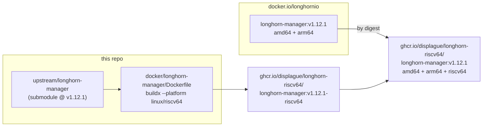
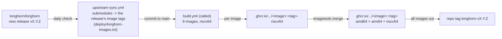

# longhorn-riscv64

[Longhorn](https://github.com/longhorn/longhorn) images for **linux/riscv64**, published so that one
Longhorn install can span amd64, arm64 and riscv64 nodes.

Upstream publishes `longhornio/*` for amd64 and arm64 only. This repo builds the riscv64 image of
each component from the **same upstream tag**, then publishes one tag per image whose manifest list
holds upstream's own amd64/arm64 images (referenced by digest, never rebuilt) plus ours. Each node's
container runtime pulls its own architecture, so the Helm chart only needs its image repositories
pointed here.



## Images

| Image | Source (submodule) | Notes |
|---|---|---|
| longhorn-manager | longhorn/longhorn-manager | pure Go; also the CSI plugin / driver-deployer image |
| longhorn-engine | longhorn/longhorn-engine | Go + cgo (libqcow); tgt + liblonghorn |
| longhorn-instance-manager | longhorn/longhorn-instance-manager | **v1 data engine only**: no SPDK (v2) |
| csi-attacher, csi-provisioner, csi-resizer, csi-snapshotter, csi-node-driver-registrar, livenessprobe | kubernetes-csi/* | Longhorn re-publishes these upstream sidecars as `longhornio/*` |

Not built yet: `longhorn-share-manager` (RWX volumes; needs nfs-ganesha), `backing-image-manager`
(backing images), `support-bundle-kit`, `longhorn-ui` and `longhorn-cli`. Their submodules are here
for later; until then keep RWX volumes, backing images and the UI off riscv64 nodes.

## How the builds differ from upstream

The Dockerfiles in `docker/<image>/` follow each component's own `package/Dockerfile` (and, for the
engine and instance-manager, the root `Dockerfile` that builds the binaries) at the pinned tag:

- **Go is cross-compiled** on the build host (`FROM --platform=$BUILDPLATFORM`, `GOARCH=riscv64`),
  using each component's own `scripts/build`. The engine and instance-manager link libqcow through
  cgo statically, so a riscv64 libqcow is built with Debian's cross toolchain first. No emulation.
- **Only the riscv64 runtime layers run under QEMU**: package installs, plus tgt + liblonghorn
  (small C builds, via the same `dep-versions` scripts upstream uses).
- **Runtime base: openSUSE Tumbleweed.** SLE BCI (upstream's base) has no riscv64; Tumbleweed does,
  with the same zypper package names. `/tini` is openSUSE's `catatonit` (tini ships no riscv64).
  CSI sidecars use `distroless/static-debian13` (the debian12 flavour has no riscv64).
- **No SPDK**: the v2 data engine stays off on riscv64.

Source patches, if ever needed, go in `patches/<submodule>/*.patch`; `scripts/prepare` applies them to
a clean clone in `build/` (the submodules themselves stay pristine). None are needed so far.

## Building

```sh
git submodule update --init
make tags                         # image -> upstream tag
make build-longhorn-manager       # out/longhorn-manager.tar (OCI, riscv64), nothing pushed
make                              # every image
make manifest-longhorn-manager    # push :<tag>-riscv64, then merge into :<tag> (needs registry login)
```

Requires Docker with buildx and QEMU binfmt for riscv64
(`docker run --privileged --rm tonistiigi/binfmt --install riscv64`).

## CI

Upstream tag to published image, with no manual step:



- `upstream-sync.yml`: daily. If Longhorn has a newer stable release, it moves the submodules to the
  exact tags that release ships, commits to `main`, and calls `build.yml` on that commit. It never
  moves backwards; `workflow_dispatch` with `version` pins a release.
- `build.yml`: pull requests build every image; runs on `main` also publish and merge them, then tag
  this repo `longhorn-<version>` once every image is out. A failed image publishes nothing (GitHub's
  failure email is the alert); older tags stay as they were.
- Dependabot keeps the GitHub Actions and the Dockerfiles' base images current (its pull requests are
  built by `build.yml`). It doesn't move the submodules: its gitsubmodule updater follows branch heads,
  and every image must come from the exact tag Longhorn released, or it wouldn't match the
  amd64/arm64 images it is merged with.

## Verifying an image

Every published digest (the riscv64 image and the merged multi-arch tag) carries a signed SLSA build
provenance attestation from `build.yml` (GitHub artifact attestations, keyless via Sigstore), naming
this repo, the commit and the workflow run that built it:

```sh
gh attestation verify oci://ghcr.io/displague/longhorn-riscv64/longhorn-manager:v1.12.1 --owner displague
```

The commit pins each submodule, so it pins the upstream source. The amd64/arm64 entries in a merged
tag are upstream's own images, referenced by digest: compare them with
`docker buildx imagetools inspect docker.io/longhornio/<image>:<tag>`.

New GHCR packages start private: make each one public once (package settings) so nodes can pull
without credentials.

## Using it

Point the chart's image repositories here (same tags as upstream):

```yaml
image:
  longhorn:
    manager: { repository: ghcr.io/displague/longhorn-riscv64/longhorn-manager }
    engine: { repository: ghcr.io/displague/longhorn-riscv64/longhorn-engine }
    instanceManager: { repository: ghcr.io/displague/longhorn-riscv64/longhorn-instance-manager }
  csi:
    attacher: { repository: ghcr.io/displague/longhorn-riscv64/csi-attacher }
    provisioner: { repository: ghcr.io/displague/longhorn-riscv64/csi-provisioner }
    resizer: { repository: ghcr.io/displague/longhorn-riscv64/csi-resizer }
    snapshotter: { repository: ghcr.io/displague/longhorn-riscv64/csi-snapshotter }
    nodeDriverRegistrar: { repository: ghcr.io/displague/longhorn-riscv64/csi-node-driver-registrar }
    livenessProbe: { repository: ghcr.io/displague/longhorn-riscv64/livenessprobe }
```

If the riscv64 nodes carry a taint (e.g. `kubernetes.io/arch=riscv64:NoSchedule`), add it to
`longhornManager.tolerations`, `longhornDriver.tolerations` and `defaultSettings.taintToleration`,
but not to `longhornUI.tolerations` (no riscv64 UI image).
